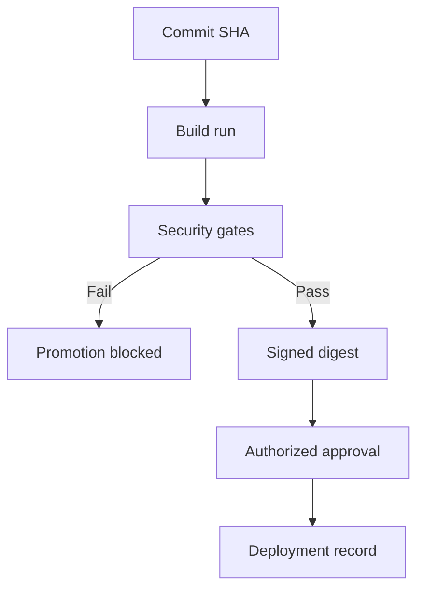

# G09-PIPE

## Question
What evidence proves pipeline controls prevent unsafe code promotion?

## Sage response

## Bottom line

The strongest proof is an end-to-end, tamper-evident evidence chain showing that a deliberately failing security check prevented merge, artifact promotion, and production deployment. Configuration screenshots or a successful scan alone are insufficient; retain the versioned pipeline definition, enforced platform policies, failed-run logs, artifact identity, approval records, and deployment audit trail linked by commit SHA and artifact digest.

## Risk and impact

Failure to enforce promotion gates is CRITICAL under PIPE-M-001 and PIPE-M-012 because vulnerable or attacker-controlled code could reach production, expose secrets, tamper with releases, or bypass authorized review. Artifact substitution remains HIGH risk under PIPE-M-011, while incorrectly ordered gates are HIGH risk under PIPE-M-007.

A defensible evidence chain demonstrates:

## Governing mandards

The complete Pipeline Security domain contains the following mandards:

MandardTitleRisk
PIPE-M-001Secure CI/CD Pipeline ConfigurationCRITICAL
PIPE-M-002Pre-Commit Hooks EnforcedCRITICAL
PIPE-M-003Use Ephemeral Build AgentsCRITICAL
PIPE-M-004Pin Build Tool VersionsMEDIUM
PIPE-M-005Vulnerability Scans for Non-ProdMEDIUM
PIPE-M-006Implement Plugin and Integration Governance in CI/CD PlatformsHIGH
PIPE-M-007Sequential Security Pipeline ExecutionHIGH
PIPE-M-008Hermetic Builds — Isolated Build EnvironmentCRITICAL
PIPE-M-009Restrict Build Parameters to Whitelisted ValuesMEDIUM
PIPE-M-010Maintain Inventory of Build Tools and VersionsHIGH
PIPE-M-011Enforce Build Immutability and Tamper-ProofingHIGH
PIPE-M-012CI/CD Workflow Least Privilege and Safe TriggersCRITICAL
PIPE-M-013Pin and Verify Third-Party CI Actions and Reusable WorkflowsHIGH
PIPE-M-014CI Runner Hardening and Cache Poisoning PreventionHIGH

The controls most directly governing promotion prevention are:

- Per PIPE-M-001: pipelines must contain explicit pre-promotion security stages, use version-controlled and auditable configuration, scan workflow definitions as a required merge check, and require authorized manual approval for critical deployments.
- Per PIPE-M-012: workflows must use least privilege, prevent untrusted code from executing with elevated access, and require manual approval for production or other critical environments.
- Per PIPE-M-011: promoted artifacts must be immutable and cryptographically signed or sealed so that the deployed object cannot be substituted after scanning.
- Per PIPE-M-007: build, security, and deployment stages must be sequentially dependent; deployment must not run unless preceding stages succeed.

Implementation guidance is provided by VeriFy-IS-RMP-001, mapped to PIPE-M-001, PIPE-M-012, ART-M-001, ART-M-002, GOV-G-006, INTEG-M-002, LOG-M-003, SECR-M-002, and SIGN-M-001:

https://wiki.example-org.internal/wiki/spaces/PMDAAME/pages/659817688

Its 'Release Management and Pipeline Guardrails' section calls for pull-request reviews and required CI checks, dependency and application security scanning, artifact signing, restricted artifact access, environment segregation, and remediation of build-phase security non-compliances before later stages proceed.

## Framework mapping

Only tool-returned mappings are shown.

MandardFrameworkControl
PIPE-M-001NIST SP 800-53 Rev. 5AC-2 Account Management; AC-3 Access Enforcement
PIPE-M-011NIST SP 800-53 Rev. 5SI-4 System Monitoring; AU-6 Audit Record Review, Analysis, and Reporting; SR-3 Supply Chain Controls and Processes; SR-4 Provenance; SA-12 Supply Chain Protection; CM-3 Configuration Change Control; SA-15 Development Process, Standards, and Tools
PIPE-M-012NIST SP 800-53 Rev. 5AC-2, AC-3, AC-4, AC-6, IA-5, SC-12, CM-3, SA-15
PIPE-M-012PCI DSS v4.0Requirement 7
PIPE-M-012ISO/IEC 27001:2022 Annex AA.5.3, A.5.15, A.5.17, A.5.18, A.8.2, A.8.3, A.8.24, A.8.25, A.8.31, A.8.32
PIPE-M-012HIPAA Security Rule164.312(a)(1)
PIPE-M-012OWASP ASVS 5.0V8 Authorization
PIPE-M-012OWASP SAMM 2.0Implementation: Secure Deployment

## Required actions

1. Prove fail-closed promotion. Per PIPE-M-001, introduce a controlled test finding above the configured release threshold. Retain evidence showing the security job failed and that merge, publication, promotion, and deployment were unavailable or skipped.
2. Prove there is no bypass path. Per PIPE-M-001, export protected-branch rules, required status checks, environment protection rules, deployment permissions, and settings preventing direct production deployment.
3. Prove sequential dependencies. Per PIPE-M-007, retain the versioned pipeline definition showing needs, dependsOn, or equivalent success conditions from build to security to deployment. Test both failed and successful paths.
4. Bind the deployed object to the scanned object. Per PIPE-M-011, record the commit SHA, build identifier, immutable artifact digest, signature or seal, registry promotion event, and deployed digest.
5. Prove authorization. Per PIPE-M-001 and PIPE-M-012, retain the production approval record with approver identity, timestamp, environment, artifact digest, and separation from the initiating account.
6. Continuously test the control. Run periodic negative tests and alert where a failed gate is followed by artifact publication, promotion, or deployment.

## Evidence for audit

EvidenceWhat it proves
Version-controlled pipeline YAML and commit historySecurity gates and stage dependencies are defined and changes are auditable.
Workflow-analyzer result recorded as a required merge checkUnsafe pipeline configuration cannot be merged without detection.
Protected-branch and environment-policy exportRequired checks and approvals are platform-enforced rather than optional conventions.
Failed SAST, SCA, IaC, DAST, secrets, or container-scan runUnsafe code triggered the configured threshold.
Same-run stage log showing promotion and deployment as blocked or skippedThe security result actively prevented promotion.
Registry audit record showing no artifact publication or promotion for the failed commitNo alternative artifact path bypassed the gate.
Commit SHA-to-build-to-digest correlationThe tested source produced the identified artifact.
Artifact signature verification and immutable-registry policyThe scanned artifact was not replaced after testing.
Production approval and deployment audit recordsOnly an authorized approval released the exact approved digest.
Controlled negative-test recordThe control was exercised, not merely inspected.
Documented deviation in the SAF pack, where applicableAny non-compliance was formally approved and justified, as directed by VeriFy-IS-RMP-001.

For each sampled release, an auditor should be able to trace one identifier chain:

commit SHA → pipeline run → scan results → immutable artifact digest → approval → deployed digest

For a failed sample, the chain must terminate at the failed gate with no subsequent promotion or deployment event.

## Assumptions and limits

No repository, CI/CD platform, registry, scan threshold, production environment, evidence-retention period, or actual failed-path test was inspected.

## Scoring notes
- actionability: pass (provisional auto-score)
- citation_correctness: pass (provisional auto-score)
- evidence_audit: pass (provisional auto-score)
- framework_mapping: pass (provisional auto-score)
- risk_impact: pass (provisional auto-score)
- bottom_line: pass (provisional auto-score)
- governing_mandards: pass (provisional auto-score)
- required_actions: pass (provisional auto-score)
- assumptions_limits: pass (provisional auto-score)
- hallucination_check: pass (provisional auto-score)
- overall_pass: pass