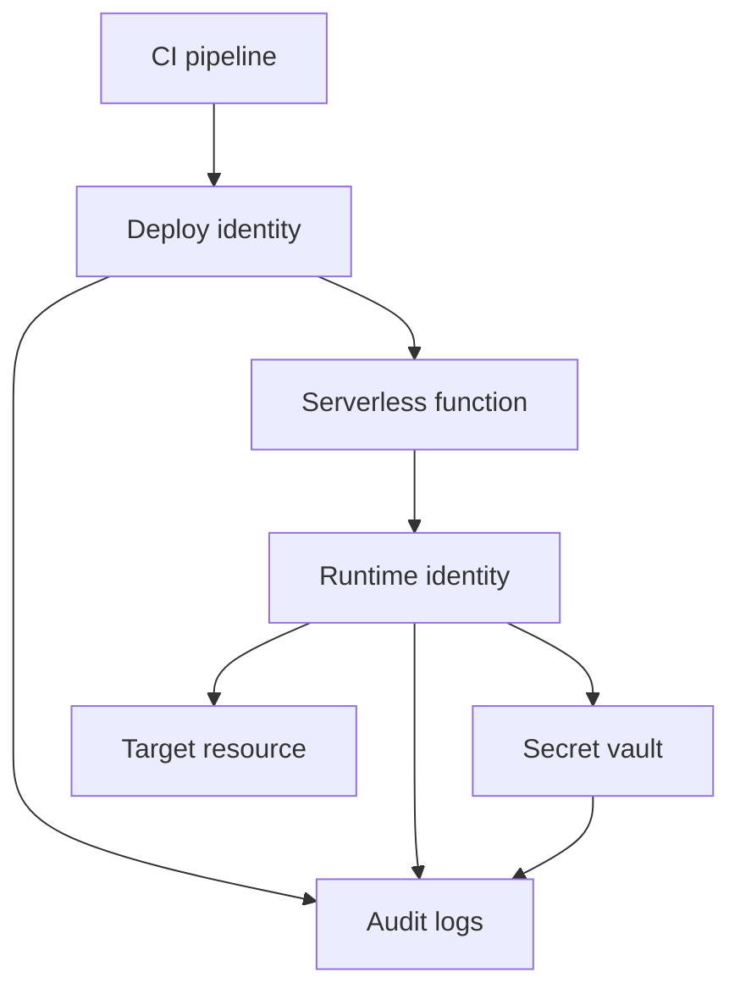

# G22-SVRL

## Question
How should we govern serverless function identity and secrets usage?

## Sage response

## Bottom line

Serverless functions must use dedicated, least-privileged workload identities and short-lived credentials rather than shared accounts or permanent access keys. Secrets must remain outside source code, deployment configuration, build artefacts, and logs; where a secret is unavoidable, retrieve it from an approved vault through the function’s managed identity. Approve this as the default deployment pattern and block releases that contain wildcard production permissions, static production credentials, or detected secrets.

## Risk and impact

The primary controls are rated **Critical**. Failure can allow a compromised function, repository, pipeline, or administrator account to expose production credentials, escalate privileges, move laterally, or access resources belonging to other environments.

Key exposures include:

- Excessive function permissions and wildcard policies.
- Shared identities that prevent attribution and increase blast radius.
- Long-lived keys copied into function settings, pipelines, or repositories.
- Secrets retained in logs, build history, deployment packages, or container images.
- Privileged changes to function identities without MFA or controlled administration.

## Governing mandards

The complete applicable Identity and Secrets domain sets are shown below.

| Mandard | Title | Risk | Application to serverless |
|---|---|---:|---|
| **IAM-M-001** | Least-Privilege IAM Policies | Critical | Function roles must contain only required actions and resources. Wildcard actions or resources are prohibited for production roles. |
| **IAM-M-002** | Enforce MFA for Privileged Accounts | Critical | Human administrators controlling functions, workload identities, vaults, and production permissions must use MFA. |
| **SECR-M-001** | No Hardcoded Secrets | Critical | High-confidence secrets in source or configuration must fail the build; exposed credentials must be invalidated and moved to an approved vault. |
| **SECR-M-002** | Prevent Secret Exposure in CI/CD Logs and History | Critical | Pipelines must redact and scan logs, clear sensitive working data, and scan deployment images for embedded secrets. |
| **SECR-M-004** | Short-Lived Credentials & Rotation | Critical | Production automation must use short-lived credentials or regularly rotated credentials; long-lived production automation secrets are prohibited. |
| **SECR-M-005** | No Secrets in Build Logs | Critical | CI systems and build logs must not contain plaintext secrets, tokens, or credentials. |
| **IAM-M-003** | Enforce Multi-Factor Authentication in CI/CD Systems | High | All human CI/CD access, including administrators, must require MFA; workload access should use OIDC rather than MFA-bypassing service credentials. |
| **IAM-M-004** | Maintain Identity Lifecycle Management for CI/CD Accounts | High | CI/CD identities require central inventory, accountable ownership, lifecycle management, and review of unused accounts. |
| **IAM-M-005** | Brokered Administrative Access | High | Privileged production administration must use a hardened, brokered or just-in-time path with MFA and session logging. |
| **SECR-M-003** | Enforce Temporary Credentials and Credential Rotation in CI/CD | High | Pipelines must use temporary credentials: no more than 15 minutes for interactive credentials and one hour for automated credentials. Remaining stored service credentials must rotate at least every 90 days. |

Per **IAM-M-001**: assign narrowly scoped permissions to exact resource identifiers and reject production policies containing wildcard actions or resources.

Per **SECR-M-001** and **SECR-M-004**: do not place static credentials in function code or deployment configuration; prefer managed identity, workload identity federation, OIDC, or equivalent temporary credential exchange.

Per **SECR-M-002** and **SECR-M-005**: secret masking alone is insufficient—logs, artefacts, deployment packages, images, and pipeline workspaces must also be scanned for exposure.

## Framework mapping

The following mappings are directly returned by the SAGF catalogue and are the principal mappings relevant to this decision:

| Mandard | Framework controls |
|---|---|
| **IAM-M-001** | NIST SP 800-53 Rev.5 `AC-2`, `AC-3`, `AC-4`, `AC-6`, `IA-2`, `IA-4`, `IA-8`; PCI DSS v4.0 `Req 7`; ISO/IEC 27001:2022 `A.5.15`, `A.5.16`, `A.5.18`, `A.8.2`, `A.8.3`, `A.8.5`; SOC 2 `CC6.1`; OWASP ASVS 5.0 `V8` |
| **IAM-M-002** | NIST SP 800-53 Rev.5 `IA-2`, `IA-5`, `AC-2`, `AC-3`, `AC-6`, `AC-7`, `SC-12`; PCI DSS v4.0 `Req 7`, `Req 8`; ISO/IEC 27001:2022 `A.5.17`, `A.8.5` |
| **IAM-M-003** | NIST SP 800-53 Rev.5 `IA-2`, `IA-5`, `AC-2`, `AC-3`, `AC-6`, `AC-7`, `SR-3`, `SR-4`, `SA-12` |
| **IAM-M-004** | NIST SP 800-53 Rev.5 `AC-2`, `AC-3`, `AC-4`, `AC-6`, `IA-2`, `SR-3`, `SR-4`, `SA-12` |
| **IAM-M-005** | NIST SP 800-53 Rev.5 `AC-2`, `AC-6`, `AC-17`, `IA-2`, `AU-2`; ISO/IEC 27001:2022 `A.8.2`, `A.8.20`; SOC 2 `CC6`; CIS Controls v8 `CIS 5`, `CIS 6`, `CIS 12`; NIST CSF 2.0 `PR.AA`, `PR.IR`, `DE.CM` |
| **SECR-M-003** | NIST SP 800-53 Rev.5 `IA-2`, `IA-5`, `AC-4`, `AC-7`, `SC-8`, `AU-2` |
| **SECR-M-004** | NIST SP 800-53 Rev.5 `IA-5`, `SC-12`, `SR-3`, `SR-4`, `SA-12`; ISO/IEC 27001:2022 `A.5.17`, `A.8.24`; SOC 2 `CC6.1`; OWASP SAMM 2.0 `Implementation: Secure Build`; OWASP Cheat Sheet Series `Secrets Management` |
| **SECR-M-005** | NIST SP 800-53 Rev.5 `AU-2`, `AU-6`, `AU-12`, `SI-4`, `IA-5`, `SC-12`; PCI DSS v4.0 `Req 10`; ISO/IEC 27001:2022 `A.8.15`, `A.8.16`, `A.5.17`; SOC 2 `CC6.1`, `CC7.2`; HIPAA `164.312(b)` |

## Required actions

1. **Give each function a dedicated workload identity.**  
   **Owner:** Cloud platform team and application owner.  
   Per **IAM-M-001**, grant only the actions and resource identifiers the function needs. Do not reuse a broad application, subscription, project, or account-level role across unrelated functions.

2. **Separate identities and secret stores by environment.**  
   **Owner:** Cloud platform team.  
   The authorization guidance requires unique service accounts for interconnecting services and different environments, accountable ownership, least privilege, and access logging. Source: **VeriFy-AUTHZ-GEN-001**, mapped to **IAM-M-001**, **IAM-M-002**, **SECR-M-001**, and **SECR-M-004**:  
   https://wiki.example-org.internal/wiki/spaces/PMDAAME/pages/659947766

3. **Use native workload identity before any stored secret.**  
   **Owner:** Application engineering.  
   Per **SECR-M-004**, use managed identity, workload identity federation, OIDC, STS, or role assumption so credentials are generated temporarily. Use separate deployment and runtime identities; the deployment identity must not become the function’s runtime identity.

4. **Retrieve unavoidable secrets from an approved vault.**  
   **Owner:** Application engineering and secrets-management team.  
   The organizational guidance specifies managed identity access to Azure Key Vault and `Get`-only access for custom applications. Applications needing `List` require a dedicated vault. Source: **VeriFy-AUTHZ-GEN-001**, mapped to **IAM-M-001**, **SECR-M-001**, and **SECR-M-004**:  
   https://wiki.example-org.internal/wiki/spaces/PMDAAME/pages/659947766

   **Advisory (not catalogue-backed):** Pass secret identifiers or vault references in function configuration—not plaintext values. Where the platform supports runtime vault references, ensure the function identity is still the principal authorized to resolve them.

5. **Block wildcard and privilege-expanding policies in infrastructure as code.**  
   **Owner:** Cloud platform and DevSecOps teams.  
   Per **IAM-M-001**, fail the deployment gate when a production function policy contains wildcard actions or resources. Require security approval for sensitive permission changes and apply permission boundaries where supported.

6. **Enforce secret scanning throughout delivery.**  
   **Owner:** DevSecOps team.  
   Per **SECR-M-001**, scan every commit and pull request and fail on a high-confidence secret. Per **SECR-M-002** and **SECR-M-005**, also scan pipeline logs, generated artefacts, serverless deployment packages, layers, and container images.

7. **Use federated CI/CD deployment credentials.**  
   **Owner:** DevSecOps and cloud platform teams.  
   Per **SECR-M-003**, automated pipeline credentials must have a TTL of no more than one hour, and static API keys must not be used in pipelines. If a residual stored credential cannot yet be eliminated, rotate it at least every 90 days, log the rotation, and automatically revoke overdue credentials.

8. **Prevent secret disclosure through diagnostics.**  
   **Owner:** Application engineering and observability teams.  
   Per **SECR-M-002** and **SECR-M-005**, redact secrets from logs and do not print environment variables, authorization headers, tokens, connection strings, or complete event payloads that may contain credentials. A detected secret must fail the relevant pipeline control and trigger immediate revocation.

9. **Protect privileged administration.**  
   **Owner:** IAM and cloud operations.  
   Per **IAM-M-002**, administrators must use MFA. Per **IAM-M-005**, production administration must use brokered or just-in-time access with short-lived credentials and privileged-session logging.

10. **Govern identity ownership and exceptions.**  
    **Owner:** Application owner and GRC.  
    Maintain an inventory containing the identity, environment, owner, assigned permissions, actual permissions used, creation and last-use dates, and connected functions. Although **IAM-M-004** specifically governs CI/CD identities, the same ownership model should be applied to serverless runtime identities as an **Advisory (not catalogue-backed)**. Any departure from the preferred guidance must be documented as a deviation with technical justification in the SAF pack, as stated in **VeriFy-AUTHZ-GEN-001**.

The deployment identity creates or updates the function but should not receive runtime data permissions. The runtime identity receives only the vault and target-resource permissions needed by that specific function.

The CI/CD implementation standard additionally requires secure-vault injection, environment segregation, zero hardcoded credentials, and security controls across source, build, test, artefact, and deployment phases. Source: **VeriFy-IS-RMP-001**, mapped to **SECR-M-002** and other pipeline mandards:  
https://wiki.example-org.internal/wiki/spaces/PMDAAME/pages/659817688

## Evidence for audit

Retain the following evidence for each serverless service:

- Infrastructure-as-code showing the function identity, trust policy, exact permissions, permission boundary, and environment scope.
- IAM policy-lint and cloud-policy scan results proving no production wildcard permissions under **IAM-M-001**.
- Function-to-identity-to-resource inventory with accountable owner and last review date.
- Vault access policy showing the runtime identity and permitted secret operations.
- Evidence that deployment uses OIDC, managed identity, or another temporary credential exchange, including configured TTL.
- Credential-age report and rotation/revocation logs for any approved residual credentials.
- Repository, pull-request, pipeline-log, deployment-package, and image secret-scan reports.
- Pipeline configuration proving that high-confidence secret findings fail the build.
- Redaction test demonstrating that synthetic secrets appear as masked values in logs.
- MFA and privileged-access reports for administrators, including just-in-time activation and session logs.
- Approval and expiry record for every exception or deviation.

## Assumptions and limits

No cloud platform was specified, so provider-specific AWS Lambda, Azure Functions, or Google Cloud Functions configuration was not verified. No serverless-specific knowledge document was found; the implementation guidance above uses the retrieved general authorization and CI/CD standards, with serverless-specific extrapolations explicitly labelled as advisory. The initial combined governance search returned knowledge guidance but no mandards; requirements were subsequently verified from the complete **IAM-M** and **SECR-M** domain catalogues.

### Evidence and framework mapping

| Mandard | Risk | Domain | Frameworks cited (controls) |
| --- | --- | --- | --- |
| [**IAM-M-001**](https://verify.example-org.internal/?id=IAM-M-001) | Critical | Identity & Access Management | AIUC1 (B007); CIS_CONTROLS (CIS 5, CIS 6); COBIT_2019 (DSS05.04); CSA_CCM (IAM); CWE (CWE-269, CWE-284, CWE-285); ENISA_SMLA (SMLA-02, SMLA-17); +14 more |
| [**IAM-M-002**](https://verify.example-org.internal/?id=IAM-M-002) | Critical | Identity & Access Management | CIS_CONTROLS (CIS 5, CIS 6); COBIT_2019 (DSS05.04); CSA_CCM (IAM); CWE (CWE-284, CWE-285, CWE-798); ENISA_SMLA (SMLA-17); HIPAA (164.312(a)(1)); +12 more |
| [**IAM-M-003**](https://verify.example-org.internal/?id=IAM-M-003) | High | Identity & Access Management | CIS_CONTROLS (CIS 15, CIS 2, CIS 5); COBIT_2019 (APO10.01, APO10.04, DSS05.04); CWE (CWE-284, CWE-285, CWE-798); HIPAA (164.312(a)(1)); ISO_27001 (A.5.15, A.5.16, A.5.17); MITRE_ATT&CK (M1018, M1026, M1032); +10 more |
| [**IAM-M-004**](https://verify.example-org.internal/?id=IAM-M-004) | High | Identity & Access Management | CIS_CONTROLS (CIS 15, CIS 2, CIS 5); COBIT_2019 (APO10.01, APO10.04, DSS05.04); CWE (CWE-284, CWE-285); HIPAA (164.312(a)(1)); ISO_27001 (A.5.15, A.5.16, A.5.18); MITRE_ATT&CK (M1018, M1026, M1032); +10 more |
| [**IAM-M-005**](https://verify.example-org.internal/?id=IAM-M-005) | High | Identity & Access Management | CIS_CONTROLS (CIS 12, CIS 5, CIS 6); ISO_27001 (A.8.2, A.8.20); MITRE_ATT&CK (M1018, M1026, M1032); NIST_CSF (DE.CM, PR.AA, PR.IR); NIST_SP_800_53 (AC-17, AC-2, AC-6); SOC2 (CC6) |
| [**SECR-M-001**](https://verify.example-org.internal/?id=SECR-M-001) | Critical | Secrets Management | AIUC1 (A008); CIS_CONTROLS (CIS 15, CIS 2, CIS 5); COBIT_2019 (APO10.01, APO10.04, DSS05.04); CWE (CWE-284, CWE-285, CWE-798); HIPAA (164.312(a)(1)); ISO_27001 (A.5.15, A.5.16, A.5.17); +12 more |
| [**SECR-M-002**](https://verify.example-org.internal/?id=SECR-M-002) | Critical | Secrets Management | CIS_CONTROLS (CIS 15, CIS 2, CIS 4); COBIT_2019 (APO10.01, APO10.04, BAI09.01); CSA_CCM (IVS: Infrastructure & Virtualization Security); CWE (CWE-798); HIPAA (164.312(b)); ISO_27001 (A.5.16, A.5.17, A.5.19); +12 more |
| [**SECR-M-003**](https://verify.example-org.internal/?id=SECR-M-003) | High | Secrets Management | CIS_CONTROLS (CIS 15, CIS 2, CIS 5); COBIT_2019 (APO10.01, APO10.04, DSS05.04); CWE (CWE-798); HIPAA (164.312(b)); ISO_27001 (A.5.16, A.5.17, A.5.19); MITRE_ATT&CK (M1039); +12 more |
| [**SECR-M-004**](https://verify.example-org.internal/?id=SECR-M-004) | Critical | Secrets Management | CIS_CONTROLS (CIS 15, CIS 2); COBIT_2019 (APO10.01, APO10.04); CWE (CWE-798); ISO_27001 (A.5.17, A.5.19, A.5.21); MITRE_ATT&CK (M1039); NIST_CSF (GV.SC-01, ID.RA-09, PR.PS-06); +9 more |
| [**SECR-M-005**](https://verify.example-org.internal/?id=SECR-M-005) | Critical | Secrets Management | AIUC1 (A008); CIS_CONTROLS (CIS 15, CIS 2, CIS 8); COBIT_2019 (APO10.01, APO10.04, DSS05.07); CWE (CWE-798); HIPAA (164.312(b)); ISO_27001 (A.5.17, A.5.19, A.5.21); +12 more |

Source: VeriFy mandard catalogue. Framework citations are read from the recorded control mappings, not inferred by the assistant.
## Scoring notes
- actionability: pass (provisional auto-score)
- citation_correctness: pass (provisional auto-score)
- evidence_audit: pass (provisional auto-score)
- framework_mapping: pass (provisional auto-score)
- risk_impact: pass (provisional auto-score)
- bottom_line: pass (provisional auto-score)
- governing_mandards: pass (provisional auto-score)
- required_actions: pass (provisional auto-score)
- assumptions_limits: pass (provisional auto-score)
- hallucination_check: pass (provisional auto-score)
- overall_pass: pass