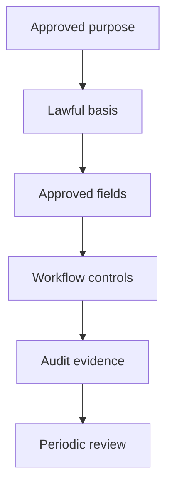

# G38-DATA

## Question
How do we prove data minimization and lawful processing in application workflows?

## Sage response

## Bottom line

Prove data minimization by maintaining a field-level processing inventory and showing that application controls collect, expose, retain, and transfer only approved data. Prove lawful processing separately through a Legal or Privacy-approved purpose and lawful-basis record linked to each workflow and its deployed policy version. The SAGF catalogue provides a **High-risk** data-classification and handling control, but no suitable Mandard was found that expressly defines lawful basis or data-minimization requirements; Legal or the DPO should therefore approve the interim evidence model and sponsor a dedicated Mandard.

## Risk and impact

Per **DATA-M-002**: services must declare data sensitivity and apply storage, transit, and retention rules appropriate to that classification.

Failure to establish this evidence creates a **High** catalogue risk: sensitive information may receive inappropriate protection, resulting in compliance failures or breaches. Separately, without a demonstrable purpose and lawful basis, the organisation may be unable to establish that personal-data processing was authorised, necessary, or limited to its declared purpose.

The minimum defensible evidence chain is:



## Governing mandards

| Mandard | Title | Risk | Applicable requirement |
|---|---|---:|---|
| **DATA-M-002** | Data Classification & Handling | High | Services must declare data sensitivity and apply appropriate storage, transit, and retention controls. Add classification metadata to service manifests and enforce corresponding controls through configuration and pipeline gates. |

No suitable Mandard was found that directly defines lawful processing, lawful basis, purpose limitation, consent management, or field-level data minimization. Those points below are therefore identified as advisory unless they arise from the cited implementation guidance.

## Framework mapping

The following mappings were returned for **DATA-M-002** and are most relevant to this question:

| Framework | Control | Returned requirement |
|---|---|---|
| NIST SP 800-53 Rev. 5 | SI-12 | Information Management and Retention |
| NIST SP 800-53 Rev. 5 | AU-6 | Audit Record Review, Analysis, and Reporting |
| NIST SP 800-53 Rev. 5 | SC-28 | Protection of Information at Rest |
| ISO/IEC 27001:2022 | A.5.34 | Privacy and protection of PII |
| ISO/IEC 27001:2022 | A.5.12 | Classification of information |
| ISO/IEC 27001:2022 | A.5.13 | Labelling of information |
| ISO/IEC 27001:2022 | A.8.16 | Monitoring activities |
| ISO/IEC 27001:2022 | A.8.33 | Test information |

These mappings support classification, retention, privacy protection, and monitoring. They must not be treated as evidence that a particular lawful basis has been established.

## Required actions

### Required control: classification and handling

1. **Create a deployable data inventory.**  
   Per **DATA-M-002**, document every data type handled by the service, including PII and other sensitive categories. Record the classification in the service manifest or equivalent configuration.

   ```yaml
   metadata:
     dataClassification: PII
   ```

2. **Apply classification-driven controls.**  
   Per **DATA-M-002**, map each classification to storage, transit, retention, encryption, and DLP controls. Make the controls enforceable in infrastructure and application configuration rather than relying only on design documentation.

3. **Introduce a pipeline gate.**  
   Per **DATA-M-002**, fail builds where classification metadata is absent or where a service handling PII lacks its required encryption, limited-retention, or DLP controls.

   ```bash
   ./ci/check-classification.sh service-manifest.yaml
   ```

### Implementation guidance from the knowledge corpus

**VeriFy-APP-002**, *5. Application Layer (Governance)*  
Source: https://wiki.example-org.internal/wiki/spaces/PMDAAME/pages/659817782  
Mapped Mandards: **ASSURE-M-001**, **CLOUD-M-007**, **CRYPT-M-001**, **DATA-M-002**, **GOV-G-006**, **OAUTH-M-001**, **SUPPLY-M-001**

The document states that:

- New applications across on-premises, Azure, offsite, and SaaS environments pass applicable governance gates, including SAF approval and application onboarding.
- External IaaS/PaaS and SaaS solutions require a Data Governance or Data Risk Assessment.
- External solutions require Legal artefacts including a Privacy Impact Assessment and POPIA agreement.
- Where relevant, cross-border transfer and offsite-hosting agreements are required.
- Hosting jurisdiction must be confirmed.
- Data-destruction terms and backup encryption are expected for external services.
- Non-compliance must be recorded as a deviation in the SAF pack with technical justification.

Only **DATA-M-002** was retrieved and verified in detail for this response. Requirements and risk levels for the other Mandard references above have not been inferred from the knowledge document.

### Advisory control design for minimization and lawful processing

**Advisory (not catalogue-backed):** Create a version-controlled **workflow processing-control matrix**. For each workflow and each personal-data field, record:

| Attribute | Evidence expected |
|---|---|
| Workflow and processing purpose | Approved business-purpose statement |
| Data field and classification | Schema or data-catalog entry |
| Necessity | Explanation of why the workflow cannot operate without it |
| Lawful basis | Legal or Privacy decision and approval reference |
| Data source | User, internal system, third party, or derived value |
| Recipients | Services, teams, processors, and external parties |
| Allowed operations | Collect, view, update, infer, export, or delete |
| Retention trigger and period | Executable retention policy |
| User notice or consent | Notice version and consent event where applicable |
| Technical enforcement | Form schema, API policy, authorization rule, or deletion job |
| Owner and review date | Business owner and Privacy reviewer |

4. **Enforce minimization at every collection point.**  
   **Advisory (not catalogue-backed):**

   - Remove fields without approved purpose and necessity.
   - Reject undeclared fields at API boundaries.
   - Do not copy optional fields into analytics, telemetry, logs, or events by default.
   - Use allow-listed response schemas to prevent excessive disclosure.
   - Use derived, pseudonymous, or aggregated values where the original identifier is unnecessary.

5. **Bind processing to purpose.**  
   **Advisory (not catalogue-backed):** Represent the approved purpose, lawful basis, and policy version as controlled metadata. At sensitive workflow transitions, evaluate whether the requested processing operation is permitted for that purpose. A generic user role alone does not prove lawful processing.

6. **Treat consent as one possible basis, not the default.**  
   **Advisory (not catalogue-backed):** Where Legal determines consent is the applicable basis, preserve the notice version, consent scope, timestamp, acquisition channel, and withdrawal status. Prevent processing after withdrawal unless Legal has documented another applicable basis.

7. **Automate retention and deletion.**  
   Per **DATA-M-002**, handling must include retention appropriate to classification. Implement scheduled deletion or anonymisation, cover replicas and downstream stores, and test the job against representative records.

8. **Reassess when the workflow changes.**  
   **Advisory (not catalogue-backed):** Block release or require Privacy review when a change introduces a new field, purpose, recipient, inference, jurisdiction, retention period, or third-party processor.

## Evidence for audit

An audit pack should connect governance approval to deployed behaviour:

1. **Approved processing-control matrix**
   - One record per workflow and data field.
   - Business owner and Legal or Privacy approval.
   - Purpose, lawful basis, necessity, recipients, and retention.
   - Version linked to the deployed release.

2. **Data classification evidence**
   - Service manifest containing the classification.
   - Data catalogue export.
   - Database, message, API, and object-storage classification records.

3. **Collection and disclosure tests**
   - UI and API schema showing only approved fields.
   - Negative test demonstrating that undeclared fields are rejected.
   - API response tests showing fields not needed by the caller are omitted.
   - Event, analytics, and log scans showing that unapproved personal data is absent.

4. **Pipeline evidence**
   - Successful **DATA-M-002** classification gate.
   - Failed-build example for missing classification or retention configuration.
   - Deployment record tying the approved control-matrix version to the release.

5. **Runtime decision evidence**
   - Workflow identifier, purpose identifier, policy version, decision, timestamp, and actor or service identity.
   - Do not place unnecessary raw personal data in the audit log.
   - Sample traces demonstrating both permitted and denied processing paths.

6. **Retention and deletion evidence**
   - Configured retention policy and deletion-job schedule.
   - Execution reports showing records selected, deleted, anonymised, or placed under legal hold.
   - Reconciliation across primary stores, search indexes, caches, exports, and downstream datasets.

7. **Governance evidence**
   - SAF approval and application onboarding record.
   - For external IaaS/PaaS or SaaS: Data Risk Assessment, Privacy Impact Assessment, POPIA agreement, jurisdiction assessment, and relevant transfer or hosting agreement, as specified by **VeriFy-APP-002**.
   - Approved and time-bound deviation record where the documented guardrails are not met.

A strong proof sample starts with one production transaction and traces it backwards to the approved purpose and lawful basis, then forwards through collection, storage, disclosure, retention, and eventual deletion.

## Assumptions and limits

- No suitable SAGF Mandard was found that expressly governs lawful basis, purpose limitation, consent, or field-level data minimization.
- Applicable privacy law and jurisdiction were not established. Legal or the DPO must determine the valid lawful basis and required statutory records.
- Only **DATA-M-002** was retrieved in detail; other Mandards referenced by **VeriFy-APP-002** were not evaluated.
- The catalogue evidence does not establish that current application workflows, processing records, or runtime controls are compliant.
- A dedicated privacy Mandard should be drafted to standardise lawful-basis recording, purpose binding, minimization tests, consent evidence, and release gating.

### Evidence and framework mapping

| Mandard | Risk | Domain | Frameworks cited (controls) |
| --- | --- | --- | --- |
| [**ASSURE-M-001**](https://verify.example-org.internal/?id=ASSURE-M-001) | High | Independent Assurance | AIUC1 (B001, C010, C011); CIS_CONTROLS (CIS 18); ISO_27001 (A.5.35); ISO_27034 (ASMP.5); NIST_800_82 (5.2.1); NIST_CSF (GV.OV, GV.OV-01, GV.OV-03); +4 more |
| [**CLOUD-M-007**](https://verify.example-org.internal/?id=CLOUD-M-007) | High | Cloud Security | AIUC1 (E005, E011); CIS_CONTROLS (CIS 3, CIS 4); COBIT_2019 (APO12.01, APO13.01, BAI09.01); CSA_CCM (DSP: Data Security & Privacy, IVS: Infrastructure & Virtualization Security); CWE (CWE-327); GDPR (Article 32, Article 44); +11 more |
| [**CRYPT-M-001**](https://verify.example-org.internal/?id=CRYPT-M-001) | Critical | Cryptography | CIS_CONTROLS (CIS 11, CIS 17, CIS 3); COBIT_2019 (DSS02.01, DSS05.07, MEA03.01); CSA_CCM (CEK); CWE (CWE-327); GDPR (Article 32); HIPAA (164.312(a)(2)(iv)); +13 more |
| [**DATA-M-002**](https://verify.example-org.internal/?id=DATA-M-002) | High | Data Protection | AIUC1 (A001, A002); CCPA_CPRA (Consumer Right to Correct, Consumer Right to Delete, Notice at Collection); CIS_CONTROLS (CIS 17, CIS 3, CIS 8); COBIT_2019 (APO14, DSS02.01, DSS05.07); ENISA_SMLA (SMLA-14, SMLA-16); GDPR (Article 13, Article 16, Article 18); +13 more |
| [**OAUTH-M-001**](https://verify.example-org.internal/?id=OAUTH-M-001) | Critical | OAuth Security | CIS_CONTROLS (CIS 15, CIS 2, CIS 5); COBIT_2019 (APO10.01, APO10.04, DSS05.04); CWE (CWE-798); ISO_27001 (A.5.16, A.5.17, A.5.19); NIST_CSF (GV.SC-01, ID.RA-09, PR.AA-01); NIST_SP_800_53 (AC-4, AC-7, IA-2); +9 more |
| [**SUPPLY-M-001**](https://verify.example-org.internal/?id=SUPPLY-M-001) | High | Supply Chain Security | AIUC1 (E006); CCPA_CPRA (Service Provider and Contractor Obligations); CIS_CONTROLS (CIS 15, CIS 17, CIS 2); COBIT_2019 (APO10.01, APO10.04, APO12.01); CSA_CCM (STA); ENISA_SMLA (SMLA-20, SMLA-22); +18 more |

Source: VeriFy mandard catalogue. Framework citations are read from the recorded control mappings, not inferred by the assistant.
## Scoring notes
- actionability: pass (provisional auto-score)
- citation_correctness: pass (provisional auto-score)
- evidence_audit: pass (provisional auto-score)
- framework_mapping: pass (provisional auto-score)
- risk_impact: pass (provisional auto-score)
- bottom_line: pass (provisional auto-score)
- governing_mandards: pass (provisional auto-score)
- required_actions: pass (provisional auto-score)
- assumptions_limits: pass (provisional auto-score)
- hallucination_check: pass (provisional auto-score)
- overall_pass: pass