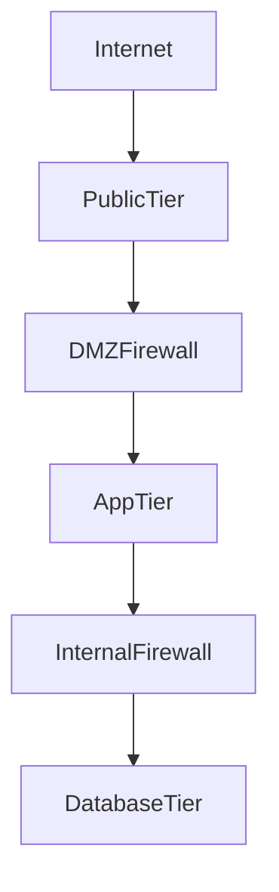

# G40-NET

## Question
What network-segmentation evidence is required for tiered application deployment?

## Sage response

## Bottom line

Per **NSEG-M-002**, a tiered application must demonstrate that public-facing services are in a DMZ, application and database tiers are isolated, and inter-tier traffic is restricted to explicitly approved ports and protocols. Release evidence should include the approved network topology, deployed firewall/security-group configuration, network-mapping or reachability test results, and proof that the database is not publicly reachable. A deployment that cannot produce this evidence carries a **High** risk of a compromised public tier reaching internal systems.

## Risk and impact

**High risk.** The exposed condition is lateral movement from an internet-facing web or load-balancer tier into application, database, or internal networks. This may result in database compromise, unauthorised access to internal systems, data loss, and expansion of the incident blast radius.

The expected segmented pattern is:

Only approved flows should traverse each boundary. The database tier must not be placed in the DMZ or directly reachable from the internet.

## Governing mandards

| Mandard | Title | Risk | Requirement |
|---|---|---:|---|
| **NSEG-M-002** | DMZ & Network Segmentation | High | Internet-facing applications must be deployed in a DMZ separated from the internal network by a firewall. DMZ-to-internal communication must permit only specific ports and protocols, and databases must not reside in the DMZ. |

Per **NSEG-M-002**: application, database, and load-balancer tiers must be placed in separate subnets or VLANs; public-facing services use a DMZ; and security groups or network ACLs allow only defined inter-tier traffic.

## Framework mapping

The catalogue maps **NSEG-M-002** to the following controls:

| Framework | Control | Mapped requirement |
|---|---|---|
| NIST SP 800-53 Rev. 5 | CM-2 | Baseline Configuration |
| NIST SP 800-53 Rev. 5 | CM-6 | Configuration Settings |
| NIST SP 800-53 Rev. 5 | SC-7 | Boundary Protection |
| NIST SP 800-53 Rev. 5 | AC-4 | Information Flow Enforcement |
| NIST SP 800-53 Rev. 5 | SC-5 | Denial-of-Service Protection |
| PCI DSS v4.0 | Req 1 | Install and Maintain Network Security Controls |
| ISO/IEC 27001:2022 | A.8.9 | Configuration management |
| ISO/IEC 27001:2022 | A.8.20 | Networks security |
| ISO/IEC 27001:2022 | A.8.21 | Security of network services |
| ISO/IEC 27001:2022 | A.8.22 | Segregation of networks |
| ISO/IEC 27001:2022 | A.8.27 | Secure system architecture and engineering principles |
| OWASP Cheat Sheet Series | Infrastructure as Code Security | Infrastructure as Code Security |
| COBIT 2019 | BAI09.01 | Identify and Record Current Assets |
| COBIT 2019 | DSS05.02 | Manage Network and Connectivity Security |
| CIS Controls v8 | CIS 4 | Secure Configuration |
| CIS Controls v8 | CIS 12 | Network Infrastructure Management |
| NIST CSF 2.0 | PR.IR-01 | Networks and Environments Protected |
| NIST CSF 2.0 | PR.PS-01 | Configuration Management Practices |
| TOGAF | Infrastructure Security | Platform, network, cloud and container security |
| MITRE ATT&CK | M1030 | Network Segmentation |
| MITRE ATT&CK | M1035 | Limit Access to Resource Over Network |
| NIST 800-82 | 5.2.3 | Layer 3 — Network Security |

## Required actions

1. **Document the tier boundaries — Architecture or solution owner**
   - Identify internet-facing, DMZ, application, database, management, and internal tiers.
   - Record subnets or VLANs, trust boundaries, ingress and egress paths, and every permitted inter-tier connection.

2. **Deploy physical or logical separation — Network/cloud engineering**
   - Place application, database, and load-balancer tiers in separate subnets or VLANs.
   - Place public-facing services in the DMZ.
   - Keep databases out of the DMZ and remove public addressing or internet routes.

3. **Enforce least-connectivity rules — Network/cloud engineering**
   - Configure firewalls, security groups, and network ACLs with explicit source, destination, protocol, and port constraints.
   - Deny unapproved traffic by default.
   - Avoid broad sources such as `0.0.0.0/0` on database ports.

4. **Verify the deployed state — Security assurance**
   - Audit the deployed topology against the approved design.
   - Review effective firewall, route-table, security-group, and network-ACL rules.
   - Perform network mapping and both positive and negative reachability tests.
   - Confirm approved tier-to-tier flows succeed and all other paths fail.
   - Test specifically that the database cannot be reached from the internet or public tier except through an explicitly approved application flow.

5. **Record deviations — Solution owner and security approver**
   - The mapped Network/Connectivity guidance requires non-compliance to be formally recorded as a deviation in the SAF pack with technical justification.
   - Source: **VeriFy-NET-001**, mapped to **NSEG-M-002** — [Network / Connectivity Layer](https://wiki.example-org.internal/wiki/spaces/PMDAAME/pages/652023403).

## Evidence for audit

The minimum defensible evidence package is:

| Evidence | What it must demonstrate |
|---|---|
| Approved network architecture or data-flow diagram | DMZ and tier locations, trust boundaries, subnet/VLAN assignments, firewalls, and permitted flows |
| Deployed configuration export or infrastructure-as-code plan | Separate tiers and the actual firewall, security-group, network-ACL, routing, and private-endpoint configuration |
| Firewall rule matrix | Each rule’s business purpose, source, destination, protocol, port, environment, owner, and approval |
| Effective configuration or cloud-console evidence | The approved configuration is deployed, not merely documented in design |
| Network mapping and reachability results | Approved paths succeed; prohibited cross-tier and internet-to-database paths time out or fail |
| Public-exposure scan | No database service is reachable through public addressing or `0.0.0.0/0` rules |
| Pipeline or policy-as-code result, where automated | Infrastructure changes passed segmentation and public-exposure checks before deployment |
| SAF deviation record, if applicable | The exception, technical justification, risk acceptance, compensating controls, owner, and approval |

**Knowledge guidance used:** **VeriFy-NET-001**, mandard reference **NSEG-M-002**, requires configured firewall DMZ access control for perimeter deployments and, for cloud deployments, configured micro-segmentation through virtual networks and security groups plus private endpoints. Source: [Network / Connectivity Layer](https://wiki.example-org.internal/wiki/spaces/PMDAAME/pages/652023403).

Other documents mapped to **NSEG-M-002**—**VeriFy-DATA-EA-001**, **VeriFy-DECOM-002**, **VeriFy-INT-002**, **VeriFy-INT-MQ-001**, and **VeriFy-WS-002**—were set aside because they address specialised transfer, decommissioning, integration, messaging, or web-service use cases rather than the baseline evidence package for tiered deployment.

## Assumptions and limits

The catalogue does not specify an evidence-retention period, mandatory evidence template, or named scanning product for **NSEG-M-002**. The exact approved ports and protocols depend on the application design and were not provided.

### Evidence and framework mapping

| Mandard | Risk | Domain | Frameworks cited (controls) |
| --- | --- | --- | --- |
| [**NSEG-M-002**](https://verify.example-org.internal/?id=NSEG-M-002) | High | Network Segmentation | CIS_CONTROLS (CIS 12, CIS 4); COBIT_2019 (BAI09.01, DSS05.02); ISO_27001 (A.8.20, A.8.21, A.8.22); MITRE_ATT&CK (M1030, M1035); NIST_800_82 (5.2.3); NIST_CSF (PR.IR-01, PR.PS-01); +4 more |

Source: VeriFy mandard catalogue. Framework citations are read from the recorded control mappings, not inferred by the assistant.
## Scoring notes
- actionability: pass (provisional auto-score)
- citation_correctness: pass (provisional auto-score)
- evidence_audit: pass (provisional auto-score)
- framework_mapping: pass (provisional auto-score)
- risk_impact: pass (provisional auto-score)
- bottom_line: pass (provisional auto-score)
- governing_mandards: pass (provisional auto-score)
- required_actions: pass (provisional auto-score)
- assumptions_limits: pass (provisional auto-score)
- hallucination_check: pass (provisional auto-score)
- overall_pass: pass