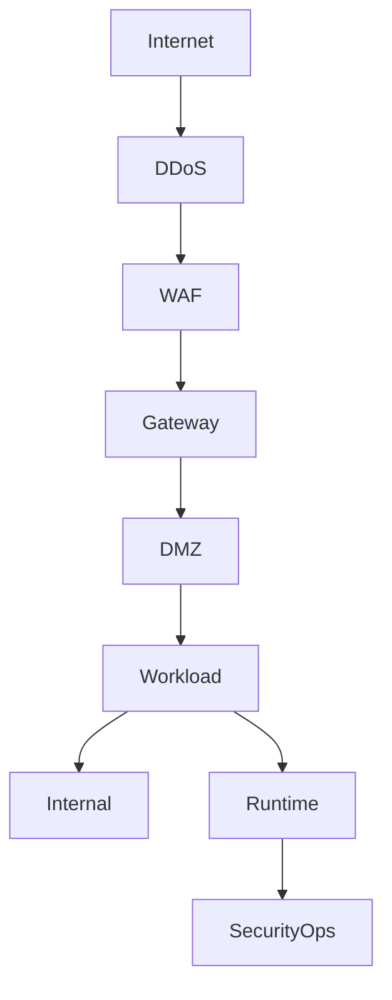

# G71-RUNTIME

## Question
What runtime protections are mandatory for internet-facing workloads?

## Sage response

## Bottom line

Internet-facing production workloads require layered protection: infrastructure-level DDoS mitigation, DMZ/network segmentation, WAF protection for HTTP/HTTPS, rate limiting for APIs, and host/container runtime protection that reports centrally. Production servers must also enforce application allowlisting; unmanaged administrative endpoints must not be permitted to access production except through a documented, time-bound exception.

Deployment should be blocked where these controls are absent or unhealthy. An approved security deviation must cover any temporary non-compliance.

## Risk and impact

| Priority | Exposure if unaddressed | Applicable Mandards |
|---|---|---|
| Critical | Volumetric, protocol, or application-layer attacks can make the service unavailable. | **GATE-M-003** |
| High | Internet compromise can lead to lateral movement into internal systems or direct database exposure. | **NSEG-M-002** |
| High | Injection, XSS, credential stuffing, resource exhaustion, and other malicious web/API traffic can reach the workload. | **WAF-M-001**, **WAF-M-002**, **GATE-M-002** |
| High | Malicious or unapproved binaries, scripts, and interpreters can execute after initial compromise. | **RUNTIME-M-003** |
| High | Compromised or unmanaged engineering and administrative endpoints can expose credentials and privileged sessions. | **RUNTIME-M-002** |
| Medium | Post-compromise behaviour may remain undetected after static and pre-deployment controls have passed. | **RUNTIME-M-001** |
| Medium | Poorly tuned WAF rules may block legitimate traffic or be disabled operationally. | **WAF-M-003** |

Only explicitly permitted traffic should cross from the DMZ workload tier to internal services; databases must not reside in the DMZ.

## Governing mandards

### Directly applicable protections

| Mandard | Title | Risk | Requirement |
|---|---|---:|---|
| **GATE-M-003** | DDoS Protection Mechanisms | Critical | Per **GATE-M-003**: applications must use infrastructure-level protection against volumetric, protocol, and application-layer DDoS attacks. |
| **NSEG-M-002** | DMZ & Network Segmentation | High | Per **NSEG-M-002**: internet-facing applications must be in a DMZ separated from internal networks; only specific ports and protocols may cross the boundary, and databases must not be in the DMZ. |
| **WAF-M-001** | WAF Rule Configuration & Management | High | Per **WAF-M-001**: inspect HTTP/HTTPS traffic through a WAF and update its rules at least weekly using threat intelligence. |
| **WAF-M-002** | OWASP CRS Enforcement | High | Per **WAF-M-002**: enforce the OWASP Core Rule Set and update it within 30 days of a release. |
| **GATE-M-002** | Rate Limiting & Throttling Controls | High | Per **GATE-M-002**: API endpoints must rate-limit by user identity, IP address, and API key. |
| **RUNTIME-M-003** | Application Allowlisting and Execution Control | High | Per **RUNTIME-M-003**: production servers must allow only approved binaries, scripts, and interpreters; violations must alert an accountable owner. |
| **RUNTIME-M-002** | Managed Endpoint and Secure Client Protection | High | Per **RUNTIME-M-002**: endpoints used to build, administer, or access production must be managed, protected, encrypted, patched, least-privileged, and subject to conditional access. |
| **RUNTIME-M-001** | Runtime Protection / EDR | Medium | Per **RUNTIME-M-001**: all production hosts and container runtimes must have approved EDR or runtime protection enabled and reporting. |
| **WAF-M-003** | WAF False Positive Tuning Process | Medium | Per **WAF-M-003**: monitor and tune WAF false positives to remain below 5%, with application-specific rule customisation. |

### Complete related domain catalogue

The related catalogue searches also returned the following Mandards; applicability depends on the service design:

| Mandard | Title | Risk | Applicability |
|---|---|---:|---|
| **GATE-M-001** | API Gateway Implementation & Enforcement | High | Related to API-based workloads; detailed applicability was not verified here. |
| **GATE-M-004** | API Versioning & Deprecation Strategy | Medium | API lifecycle control rather than a direct runtime protection. |

## Framework mapping

The following are verified, relevant mappings returned by the Mandard catalogue:

| Mandard | Framework mappings |
|---|---|
| **GATE-M-003** | NIST SP 800-53 Rev.5 `SI-4`, `AU-6`; ISO/IEC 27001:2022 `A.8.16`; SOC 2 `CC7.2`; OWASP API Security Top 10:2023 `API4:2023` |
| **NSEG-M-002** | NIST SP 800-53 Rev.5 `SC-7`, `AC-4`; PCI DSS v4.0 `Req 1`; ISO/IEC 27001:2022 `A.8.20`, `A.8.22`; CIS Controls v8 `CIS 12`; NIST CSF 2.0 `PR.IR-01` |
| **WAF-M-001** | NIST SP 800-53 Rev.5 `SI-10`, `SI-4`, `SC-7`; PCI DSS v4.0 `Req 1`, `Req 6`; ISO/IEC 27001:2022 `A.8.26`; OWASP ASVS 5.0 `V1`, `V13` |
| **WAF-M-002** | NIST SP 800-53 Rev.5 `CM-6`, `SI-10`; PCI DSS v4.0 `Req 1`, `Req 6`; OWASP ASVS 5.0 `V13`; CIS Controls v8 `CIS 16` |
| **WAF-M-003** | NIST SP 800-53 Rev.5 `AU-6`, `SI-4`; ISO/IEC 27001:2022 `A.8.16`; SOC 2 `CC7.2` |
| **GATE-M-002** | NIST SP 800-53 Rev.5 `SI-4`; OWASP ASVS 5.0 `V4`; OWASP API Security Top 10:2023 `API4:2023` |
| **RUNTIME-M-001** | NIST SP 800-53 Rev.5 `SI-4`, `AU-6`, `SI-7`; PCI DSS `Req 5`; ISO/IEC 27001:2022 `A.8.7`, `A.8.16`; SOC 2 `CC7.2`; CIS Controls v8 `CIS 10` |
| **RUNTIME-M-002** | ISO/IEC 27001:2022 `A.8.1`; CIS Controls v8 `CIS 9`; CSA CCM v4 `UEM`; MITRE ATT&CK `M1021`, `M1040`, `M1049` |
| **RUNTIME-M-003** | NIST SP 800-53 Rev.5 `CM-7`; ISO/IEC 27001:2022 `A.8.19`; CIS Controls v8 `CIS 2`, `CIS 10`; MITRE ATT&CK `M1038`, `M1033` |

## Required actions

1. **Platform/network owner — enable DDoS protection.**  
   Per **GATE-M-003**, use an infrastructure-level DDoS mitigation service covering volumetric, protocol, and application-layer attacks.

2. **Network architect — isolate the workload.**  
   Per **NSEG-M-002**, place the public tier in a DMZ, deny unrestricted DMZ-to-internal traffic, allow only documented ports and protocols, and keep databases outside the DMZ. The network guardrail additionally identifies DDoS, intrusion prevention, load balancing, firewall/DMZ controls, security logging, and cloud micro-segmentation as edge protections: **VeriFy-NET-001** `[NSEG-M-002, GATE-M-003, WAF-M-001 and related references]`, source: https://wiki.example-org.internal/wiki/spaces/PMDAAME/pages/652023403.

3. **Application/platform owner — protect HTTP/HTTPS traffic.**  
   Per **WAF-M-001**, route public web traffic through a WAF and update rules at least weekly. Per **WAF-M-002**, enable OWASP CRS and update it within 30 days of release. Per **WAF-M-003**, monitor false positives weekly, maintain a rate below 5%, and use granular application-specific exceptions rather than disabling broad rule groups.

4. **API owner — enforce abuse controls.**  
   Per **GATE-M-002**, rate-limit API traffic by identity, source IP, and API key. Verify that excessive traffic produces `429 Too Many Requests`. The externally exposed web-service guardrail explicitly requires WAF policy and analysed rate-limiting thresholds: **VeriFy-WS-002** `[WAF-M-001, GATE-M-003, NSEG-M-002]`, source: https://wiki.example-org.internal/wiki/spaces/PMDAAME/pages/659817293.

5. **Infrastructure/container platform owner — deploy runtime detection.**  
   Per **RUNTIME-M-001**, install approved EDR or runtime protection on every production host and container runtime, enrol it in central monitoring, and alert on missing or unhealthy heartbeats. The infrastructure guardrail covers endpoint security, hardening, asset management, and vulnerability management across on-premises and Azure workloads: **VeriFy-INF-002** `[RUNTIME-M-001, RUNTIME-M-002]`, source: https://wiki.example-org.internal/wiki/spaces/PMDAAME/pages/658243766.

6. **Platform and endpoint owners — enforce execution control.**  
   Per **RUNTIME-M-003**, use deny-by-default application allowlisting for production servers and privileged build/admin endpoints. Block unapproved installation and route violations and exceptions to an accountable owner. No knowledge document was found for this point.

7. **IAM/endpoint owner — restrict privileged access.**  
   Per **RUNTIME-M-002**, condition source-control administration and production access on a compliant managed device with current EDR, disk encryption, supported software, security updates, screen locking, browser/email protection, and least privilege.

## Evidence for audit

Retain the following evidence in the release or SAF pack:

- DDoS service subscription, protected-resource inventory, active policy, monitoring dashboard, and annual simulation result.
- Network diagram, firewall/security-group export, DMZ configuration, and evidence that databases have no public route.
- WAF-to-endpoint association, active prevention policy, weekly rule-update record, current CRS version, blocked-request logs, and false-positive metric.
- API rate-limit configuration and test result demonstrating `429` responses and `Retry-After` handling.
- EDR/runtime inventory showing every production host and container runtime enrolled, healthy, and reporting.
- Execution-control policy, approved binary/script inventory, violation alerts, and approved exception records.
- Endpoint compliance and conditional-access reports for privileged production access.
- Formal, time-bound deviation record for any unmet requirement.

## Assumptions and limits

“Internet-facing workload” is interpreted as a production application or service reachable from the public internet. WAF controls apply to HTTP/HTTPS services, and **GATE-M-002** applies specifically to API endpoints; applicability of **GATE-M-001** and **GATE-M-004** was not verified in detail. No knowledge documents currently reference **RUNTIME-M-003**, **WAF-M-002**, **WAF-M-003**, or **GATE-M-002**; their requirements above are taken directly from the Mandard catalogue.

### Evidence and framework mapping

| Mandard | Risk | Domain | Frameworks cited (controls) |
| --- | --- | --- | --- |
| [**GATE-M-001**](https://verify.example-org.internal/?id=GATE-M-001) | High | Gateway Security | CIS_CONTROLS (CIS 17, CIS 5, CIS 6); COBIT_2019 (BAI03.03, BAI06.01, DSS02.01); CWE (CWE-284, CWE-285); HIPAA (164.312(a)(1)); ISO_27001 (A.5.15, A.5.16, A.5.17); NIST_CSF (DE.AE-02, DE.CM-01, PR.AA-01); +10 more |
| [**GATE-M-002**](https://verify.example-org.internal/?id=GATE-M-002) | High | Gateway Security | COBIT_2019 (BAI03.03, BAI06.01); CWE (CWE-400, CWE-770, CWE-798); ISO_27001 (A.5.17, A.8.24, A.8.25); NIST_CSF (DE.CM-01, PR.PS-06); NIST_SP_800_53 (AC-4, CM-3, IA-5); NIST_SSDF (PS.1.1, PS.2.1, PW.4.1); +5 more |
| [**GATE-M-003**](https://verify.example-org.internal/?id=GATE-M-003) | Critical | Gateway Security | CIS_CONTROLS (CIS 8); COBIT_2019 (BAI03.03, BAI04, BAI06.01); CWE (CWE-400, CWE-770); ISA_62443 (SR 7); ISO_27001 (A.8.16, A.8.25, A.8.31); NIST_CSF (DE.AE-02, DE.CM-01, PR.PS-06); +8 more |
| [**GATE-M-004**](https://verify.example-org.internal/?id=GATE-M-004) | Medium | Gateway Security | COBIT_2019 (BAI03.03, BAI06.01); ISO_27001 (A.8.25, A.8.31, A.8.32); NIST_CSF (PR.PS-06); NIST_SP_800_53 (AC-4, CM-3, SA-15); NIST_SSDF (PS.1.1, PS.2.1, PW.4.1); OWASP_API (API1:2023, API2:2023, API3:2023); +4 more |
| [**NSEG-M-002**](https://verify.example-org.internal/?id=NSEG-M-002) | High | Network Segmentation | CIS_CONTROLS (CIS 12, CIS 4); COBIT_2019 (BAI09.01, DSS05.02); ISO_27001 (A.8.20, A.8.21, A.8.22); MITRE_ATT&CK (M1030, M1035); NIST_800_82 (5.2.3); NIST_CSF (PR.IR-01, PR.PS-01); +4 more |
| [**RUNTIME-M-001**](https://verify.example-org.internal/?id=RUNTIME-M-001) | Medium | Runtime Protection | CIS_CONTROLS (CIS 10, CIS 4, CIS 8); COBIT_2019 (BAI09.01, DSS05.02, DSS05.07); CSA_CCM (IVS: Infrastructure & Virtualization Security); ENISA_SMLA (SMLA-18); ISO_27001 (A.8.16, A.8.27, A.8.7); MITRE_ATT&CK (M1025, M1040, M1049); +9 more |
| [**RUNTIME-M-002**](https://verify.example-org.internal/?id=RUNTIME-M-002) | High | Runtime Protection | CIS_CONTROLS (CIS 9); CSA_CCM (UEM); ISO_27001 (A.8.1); MITRE_ATT&CK (M1021, M1040, M1049) |
| [**RUNTIME-M-003**](https://verify.example-org.internal/?id=RUNTIME-M-003) | High | Runtime Protection | CIS_CONTROLS (CIS 10, CIS 2); ISO_27001 (A.8.19); MITRE_ATT&CK (M1033, M1038); NIST_SP_800_53 (CM-7) |
| [**WAF-M-001**](https://verify.example-org.internal/?id=WAF-M-001) | High | Web Application Firewall | CIS_CONTROLS (CIS 12, CIS 16); CWE (CWE-77, CWE-79, CWE-89); ISO_27001 (A.8.20, A.8.22, A.8.26); MITRE_ATT&CK (M1020, M1021, M1031); NIST_CSF (DE.CM-01, PR.DS-01, PR.PS-01); NIST_SP_800_53 (AC-4, CM-6, SA-11); +6 more |
| [**WAF-M-002**](https://verify.example-org.internal/?id=WAF-M-002) | High | Web Application Firewall | CIS_CONTROLS (CIS 12, CIS 16); ISO_27001 (A.8.20, A.8.22, A.8.26); MITRE_ATT&CK (M1021, M1031, M1037); NIST_CSF (DE.CM-01, PR.DS-01, PR.PS-01); NIST_SP_800_53 (AC-4, CM-6, SA-11); OWASP (A02:2025); +5 more |
| [**WAF-M-003**](https://verify.example-org.internal/?id=WAF-M-003) | Medium | Web Application Firewall | CIS_CONTROLS (CIS 12, CIS 16, CIS 8); COBIT_2019 (DSS05.07, MEA03.01); ISO_27001 (A.8.16, A.8.20, A.8.22); MITRE_ATT&CK (M1021, M1031, M1037); NIST_CSF (DE.AE-02, DE.CM-01, PR.DS-01); NIST_SP_800_53 (AC-4, AU-6, CM-6); +7 more |

Source: VeriFy mandard catalogue. Framework citations are read from the recorded control mappings, not inferred by the assistant.
## Scoring notes
- actionability: pass (provisional auto-score)
- citation_correctness: pass (provisional auto-score)
- evidence_audit: pass (provisional auto-score)
- framework_mapping: pass (provisional auto-score)
- risk_impact: pass (provisional auto-score)
- bottom_line: pass (provisional auto-score)
- governing_mandards: pass (provisional auto-score)
- required_actions: pass (provisional auto-score)
- assumptions_limits: pass (provisional auto-score)
- hallucination_check: pass (provisional auto-score)
- overall_pass: pass