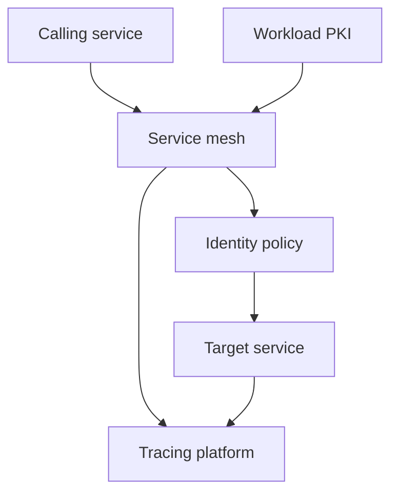

# G77-MSA

## Question
What controls are required to secure service-to-service calls in microservices?

## Sage response

## Bottom line

All service-to-service traffic must be authenticated, encrypted, and explicitly authorized; plaintext or implicitly trusted internal calls are prohibited. The minimum baseline is workload authentication using mTLS or signed JWTs, TLS 1.3+, deny-by-default authorization, automated certificate rotation, tracing, and resilience controls. Approve deployment only when these controls are enforced at runtime and evidenced through pipeline and integration tests.

## Risk and impact

The highest exposure is service impersonation, lateral movement, interception, forged tokens, and unauthorized access to sensitive operations. High-risk secondary exposures include cascading outages, untraceable transactions, insecure cross-boundary payloads, and inconsistent distributed transactions.

| Priority | Exposure |
|---|---|
| Critical | Unauthenticated calls, weak transport encryption, expired or compromised certificates, forged JWTs, and missing endpoint authorization |
| High | Missing traceability, cascading failures, reliance on perimeter-only controls, insecure distributed transactions, and insufficient network or message-level protection |

## Governing mandards

### Microservices domain — complete control set

| Mandard | Title | Risk | Requirement |
|---|---|---:|---|
| **MSA-M-001** | Service-to-Service Authentication (mTLS/JWT) | Critical | Per **MSA-M-001**: authenticate every service call using mTLS certificate authentication or digitally signed JWTs; prohibit plaintext and unauthenticated calls. |
| **MSA-M-002** | Distributed Tracing & Correlation IDs | High | Per **MSA-M-002**: propagate a unique correlation ID and deploy distributed tracing across the request chain. |
| **MSA-M-003** | Circuit Breaker & Resilience Patterns | High | Per **MSA-M-003**: implement circuit breakers, timeouts, retries, and graceful degradation to contain failures. |
| **MSA-M-004** | API Gateway vs Service Mesh Security | High | Per **MSA-M-004**: enforce controls at both layers—external authentication and rate limiting at the gateway, and internal mTLS and authorization through the service mesh. |
| **MSA-M-005** | Data Consistency & Saga Patterns Security | High | Per **MSA-M-005**: secure distributed transactions with sagas, compensating transactions, idempotent operations, and preserved security context. |

### Supporting controls

| Mandard | Title | Risk | Applicability |
|---|---|---:|---|
| **AC-M-001** | Mandatory Authorization Checks | Critical | All sensitive data access, state-changing, and administrative operations; deny by default and verify role, permission, and resource access. |
| **CRYPT-M-002** | Encryption in Transit TLS 1.3+ | Critical | HTTPS, gRPC, messaging, and all internal service traffic; disable deprecated protocols and weak ciphers. |
| **CONT-M-005** | mTLS Certificate Management & Rotation | Critical | All inter-service mTLS; automatic rotation within a maximum 90-day validity period, identity verification, and revocation checking. |
| **API-M-005** | Auth on Sensitive API | Critical | Every sensitive API, including internal APIs, must reject missing or invalid authentication with `401` or `403`. |
| **API-M-007** | JWT Signature Validation | Critical | When JWTs are used, verify signatures and reject `alg:none`; use an explicit algorithm allowlist. |
| **OAUTH-M-001** | OAuth 2.0 Token Security & Validation | Critical | When OAuth tokens carry user context, verify signature, issuer, audience, expiry, and scopes on every request; do not place tokens in URLs. |
| **API-M-006** | Rate Limiting Enforced | Critical | Required for public endpoints and applicable to external-provider REST patterns; excessive requests must eventually receive `429`. |
| **API-M-013** | Message-Level Integrity and Confidentiality | High | Required where sensitive messages cross organisational boundaries or pass through TLS-terminating intermediaries; sign payloads and encrypt confidential payloads to the recipient. |
| **NSEG-M-002** | DMZ & Network Segmentation | High | Required for internet-facing and external connections; permit only defined ports, protocols, sources, and destinations across boundaries. |

## Framework mapping

The following are selected mappings returned by the SAGF catalogue; they are not presented as an exhaustive mapping list.

| Mandard | Verified framework mappings |
|---|---|
| **MSA-M-001** | NIST SP 800-53 Rev.5: IA-2, IA-5, IA-4, AC-4, SC-7, SC-8, SC-12, SC-13; PCI DSS v4.0: Req 4, Req 8 |
| **MSA-M-002** | NIST SP 800-53 Rev.5: SI-4, AU-6; ISO/IEC 27001:2022: A.8.16; SOC 2: CC7.2; CIS Controls v8: CIS 8 |
| **MSA-M-003** | NIST SP 800-53 Rev.5: SC-5, CP-10; ISO/IEC 27001:2022: A.8.14; SOC 2: A1.2 |
| **MSA-M-004** | NIST SP 800-53 Rev.5: AC-4, SC-7, SC-8, SC-12, SC-13; PCI DSS v4.0: Req 1, Req 4; GDPR: Article 32 |
| **MSA-M-005** | NIST SP 800-53 Rev.5: SI-7; SOC 2: PI1; OWASP ASVS 5.0: V4 |
| **AC-M-001** | NIST SP 800-53 Rev.5: AC-2, AC-3, AC-4, AC-6 |
| **CRYPT-M-002** | NIST SP 800-53 Rev.5: SC-7, SC-12, SC-13; PCI DSS v4.0: Req 4; ISO/IEC 27001:2022: A.8.24; GDPR: Article 32; OWASP ASVS 5.0: V12 |
| **CONT-M-005** | NIST SP 800-53 Rev.5: CM-6, SC-12, SC-13 |
| **API-M-005** | NIST SP 800-53 Rev.5: IA-2, IA-5, AC-4, SC-8, SA-11 |
| **API-M-006** | NIST SP 800-53 Rev.5: AC-7, SC-8, SA-11 |
| **API-M-007** | NIST SP 800-53 Rev.5: IA-2, IA-5, SA-11 |
| **API-M-013** | NIST SP 800-53 Rev.5: SC-8, SC-13, SC-23, SI-7; ISO/IEC 27001:2022: A.5.14, A.8.24; OWASP ASVS 5.0: V11, V14 |
| **OAUTH-M-001** | NIST SP 800-53 Rev.5: IA-2, IA-5, SC-8; PCI DSS v4.0: Req 8; ISO/IEC 27001:2022: A.8.5; OWASP ASVS 5.0: V6, V10 |
| **NSEG-M-002** | NIST SP 800-53 Rev.5: AC-4, SC-7; PCI DSS v4.0: Req 1; ISO/IEC 27001:2022: A.8.20, A.8.22; CIS Controls v8: CIS 12 |

## Required actions

1. **Enforce workload authentication and TLS**
   - **Owner:** Platform or cloud security team.
   - Per **MSA-M-001**, configure the service mesh in strict mTLS mode and reject plaintext or unidentified workloads.
   - Per **CRYPT-M-002**, enforce TLS 1.3+ and disable deprecated protocols and weak ciphers.
   - Per **CONT-M-005**, issue a distinct identity to each service, verify peer identity and revocation, and rotate certificates automatically within 90 days.

2. **Apply deny-by-default authorization**
   - **Owner:** Service owners and application security.
   - Per **AC-M-001**, permit only named caller identities to invoke approved operations and resources.
   - Per **API-M-005**, protect internal endpoints exactly as exposed endpoints and test that missing or invalid credentials produce `401` or `403`.
   - Do not treat network location, cluster membership, or successful mTLS alone as authorization.

3. **Secure tokens where JWT or OAuth is used**
   - **Owner:** Identity platform and service owners.
   - Per **API-M-007**, verify the JWT signature and explicitly allow only approved algorithms; reject unsigned tokens.
   - Per **OAUTH-M-001**, validate issuer, audience, expiry, and scopes on every call. Access-token validity must be less than one hour.
   - Preserve user identity separately from the authenticated workload identity when a service calls another service on a user’s behalf.

4. **Separate edge and east-west controls**
   - **Owner:** Platform engineering.
   - Per **MSA-M-004**, use the API gateway for external authentication and rate limiting, while the service mesh enforces internal mTLS and authorization.
   - Per **NSEG-M-002**, restrict external and cross-zone paths to approved sources, destinations, ports, and protocols.
   - Per **API-M-006**, rate-limit public and applicable external-provider APIs and return `429` under excessive request volume.

5. **Protect messages across termination points**
   - **Owner:** Integration architecture.
   - Per **API-M-013**, sign sensitive payloads before they cross a TLS-terminating gateway or organisational boundary; encrypt confidential payloads to the intended recipient.
   - Verify signatures before processing payloads and source signing and encryption keys from the approved key-management service.

6. **Establish traceability**
   - **Owner:** Observability team and service owners.
   - Per **MSA-M-002**, create or accept a correlation ID at ingress, propagate `traceparent` and request identifiers through every synchronous and asynchronous hop, and deploy distributed tracing.
   - Ensure credentials and sensitive payloads are not included in trace attributes.

7. **Contain failures**
   - **Owner:** Service owners and reliability engineering.
   - Per **MSA-M-003**, configure bounded timeouts, controlled retries, circuit breakers, connection limits, and graceful degradation.
   - Test downstream failure and retry-storm scenarios before production approval.

8. **Secure asynchronous and distributed workflows**
   - **Owner:** Integration and application teams.
   - Per **MSA-M-005**, make distributed operations idempotent and use secure saga compensation rather than distributed locks.
   - Compensation operations must retain and validate the original security and tenancy context.

### Knowledge-backed implementation guidance

- **REST APIs:** **VeriFy-INT-REST-001**, mapped to **MSA-M-001**, **OAUTH-M-001**, **API-M-007**, **API-M-005**, **API-M-006**, **AC-M-001**, **CRYPT-M-002**, **CONT-M-005**, and **API-M-013**. It prescribes system and user-context authentication, least-privilege roles and scopes, IP allowlisting and rate limiting for external patterns, and JWS/JWE where feasible.  
  Source: https://wiki.example-org.internal/wiki/spaces/PMDAAME/pages/659981099

- **Kafka:** **VeriFy-INT-KFK-001**, mapped to **MSA-M-001**, **AC-M-001**, **CRYPT-M-002**, and **CONT-M-005**. It specifies internal-PKI mTLS and binding certificate identities to explicit topics; external patterns add provider IP allowlisting.  
  Source: https://wiki.example-org.internal/wiki/spaces/PMDAAME/pages/659947880

- **MQ:** **VeriFy-INT-MQ-001**, mapped to **MSA-M-001**, **AC-M-001**, **CRYPT-M-002**, **CONT-M-005**, and **NSEG-M-002**. It specifies mutual X.509 authentication, secure channel-authentication records, dedicated service accounts, least-privilege queue/topic access, and DMZ/IPsec protection for external connectivity.  
  Source: https://wiki.example-org.internal/wiki/spaces/PMDAAME/pages/659981128

## Evidence for audit

Retain the following in the security assurance pack:

- Service-mesh configuration showing strict mTLS and absence of permissive overrides.
- TLS scan showing TLS 1.3+, approved ciphers, and rejection of plaintext connections.
- PKI inventory showing workload identity, issuer, certificate expiry, rotation, and revocation tests.
- Authorization policies mapping caller identities to permitted services, operations, topics, or queues.
- Negative integration tests proving unknown services and unauthorized roles receive `401` or `403`.
- JWT tests proving rejection of altered, expired, wrong-audience, wrong-issuer, and `alg:none` tokens.
- Gateway rate-limit test showing `429` responses.
- Trace evidence showing correlation IDs across every service hop.
- Resilience test showing timeout, retry, circuit-breaker, and graceful-degradation behaviour.
- Network-policy, firewall, and security-group exports showing allowed flows only.
- For cross-boundary traffic, signature-tampering and payload-encryption test results.

## Assumptions and limits

The applicable communication mechanism—REST, gRPC, Kafka, MQ, or another protocol—was not specified. The REST, Kafka, and MQ knowledge standards still refer to TLS 1.2 in some implementation tables; the catalogue requirement in **CRYPT-M-002** and **CONT-M-005** is TLS 1.3+, so the stricter Mandard requirement governs. External exposure, sensitive-data classification, user-context propagation, and distributed-transaction use must be confirmed during design review.

### Evidence and framework mapping

| Mandard | Risk | Domain | Frameworks cited (controls) |
| --- | --- | --- | --- |
| [**AC-M-001**](https://verify.example-org.internal/?id=AC-M-001) | Critical | Access Control | CIS_CONTROLS (CIS 5, CIS 6); COBIT_2019 (DSS05.04); CWE (CWE-269, CWE-284, CWE-285); HIPAA (164.312(a)(1)); ISA_62443 (SR 2); ISO_27001 (A.5.15, A.5.16, A.5.18); +9 more |
| [**API-M-005**](https://verify.example-org.internal/?id=API-M-005) | Critical | API Security | CIS_CONTROLS (CIS 16, CIS 5, CIS 6); COBIT_2019 (DSS05.04); CSA_CCM (AIS); CWE (CWE-306, CWE-798); ISO_27001 (A.5.16, A.5.17, A.8.24); NIST_CSF (PR.AA-01, PR.AA-05, PR.DS-01); +8 more |
| [**API-M-006**](https://verify.example-org.internal/?id=API-M-006) | Critical | API Security | CIS_CONTROLS (CIS 16, CIS 17, CIS 5); COBIT_2019 (DSS02.01, DSS05.04, DSS05.07); HIPAA (164.312(b)); ISO_27001 (A.5.16, A.5.17, A.5.24); NIST_CSF (DE.AE-02, DE.CM-01, PR.AA-01); NIST_SP_800_53 (AC-4, AC-7, AU-12); +8 more |
| [**API-M-007**](https://verify.example-org.internal/?id=API-M-007) | Critical | API Security | CIS_CONTROLS (CIS 15, CIS 16, CIS 2); COBIT_2019 (APO10.01, APO10.04, DSS05.04); CWE (CWE-798); ISO_27001 (A.5.16, A.5.17, A.5.19); NIST_CSF (GV.SC-01, ID.RA-09, PR.AA-01); NIST_SP_800_53 (AC-4, AC-7, IA-2); +9 more |
| [**API-M-013**](https://verify.example-org.internal/?id=API-M-013) | High | API Security | ISO_27001 (A.5.14, A.8.24); NIST_CSF (PR.AA, PR.DS); NIST_SP_800_53 (SC-13, SC-23, SC-8); OWASP_ASVS (V11, V14); SOC2 (CC6) |
| [**CONT-M-005**](https://verify.example-org.internal/?id=CONT-M-005) | Critical | Container Security | CIS_CONTROLS (CIS 3, CIS 4); COBIT_2019 (BAI09.01, DSS05.02); CSA_CCM (IVS: Infrastructure & Virtualization Security); CWE (CWE-327, CWE-798); GDPR (Article 32); HIPAA (164.312(a)(2)(iv)); +10 more |
| [**CRYPT-M-002**](https://verify.example-org.internal/?id=CRYPT-M-002) | Critical | Cryptography | AIUC1 (B008); CIS_CONTROLS (CIS 12, CIS 3); CWE (CWE-327); GDPR (Article 32); HIPAA (164.312(a)(2)(iv)); ISA_62443 (SR 4); +11 more |
| [**MSA-M-001**](https://verify.example-org.internal/?id=MSA-M-001) | Critical | Microservices | CIS_CONTROLS (CIS 12, CIS 15, CIS 2); COBIT_2019 (APO10.01, APO10.04, DSS05.04); CWE (CWE-327, CWE-798); GDPR (Article 32); HIPAA (164.312(a)(2)(iv)); ISO_27001 (A.5.16, A.5.17, A.5.19); +12 more |
| [**MSA-M-002**](https://verify.example-org.internal/?id=MSA-M-002) | High | Microservices | CIS_CONTROLS (CIS 12, CIS 8); COBIT_2019 (DSS05.07, MEA03.01); ISO_27001 (A.8.16, A.8.20, A.8.22); NIST_CSF (DE.AE-02, DE.CM-01); NIST_SP_800_53 (AC-4, AU-6, SC-5); OWASP_API (API1:2023, API2:2023, API3:2023); +6 more |
| [**MSA-M-003**](https://verify.example-org.internal/?id=MSA-M-003) | High | Microservices | CIS_CONTROLS (CIS 11, CIS 12, CIS 8); COBIT_2019 (DSS05.07, MEA03.01); ISO_27001 (A.8.13, A.8.14, A.8.16); NIST_CSF (DE.AE-02, DE.CM-01); NIST_SP_800_53 (AC-4, AU-6, CP-10); OWASP_API (API1:2023, API2:2023, API3:2023); +6 more |
| [**MSA-M-004**](https://verify.example-org.internal/?id=MSA-M-004) | High | Microservices | CIS_CONTROLS (CIS 12, CIS 3, CIS 8); COBIT_2019 (DSS05.07, MEA03.01); CWE (CWE-327); GDPR (Article 32); HIPAA (164.312(a)(2)(iv)); ISO_27001 (A.5.34, A.8.16, A.8.20); +10 more |
| [**MSA-M-005**](https://verify.example-org.internal/?id=MSA-M-005) | High | Microservices | CIS_CONTROLS (CIS 12, CIS 8); COBIT_2019 (DSS05.07, MEA03.01); DORA (Art. 17-23, Art. 24-27, Art. 28-44); ISO_27001 (A.8.16, A.8.20, A.8.22); NIST_CSF (DE.AE-02, DE.CM-01); NIST_SP_800_53 (AC-4, AU-6, SC-5); +7 more |
| [**NSEG-M-002**](https://verify.example-org.internal/?id=NSEG-M-002) | High | Network Segmentation | CIS_CONTROLS (CIS 12, CIS 4); COBIT_2019 (BAI09.01, DSS05.02); ISO_27001 (A.8.20, A.8.21, A.8.22); MITRE_ATT&CK (M1030, M1035); NIST_800_82 (5.2.3); NIST_CSF (PR.IR-01, PR.PS-01); +4 more |
| [**OAUTH-M-001**](https://verify.example-org.internal/?id=OAUTH-M-001) | Critical | OAuth Security | CIS_CONTROLS (CIS 15, CIS 2, CIS 5); COBIT_2019 (APO10.01, APO10.04, DSS05.04); CWE (CWE-798); ISO_27001 (A.5.16, A.5.17, A.5.19); NIST_CSF (GV.SC-01, ID.RA-09, PR.AA-01); NIST_SP_800_53 (AC-4, AC-7, IA-2); +9 more |

Source: VeriFy mandard catalogue. Framework citations are read from the recorded control mappings, not inferred by the assistant.
## Scoring notes
- actionability: pass (provisional auto-score)
- citation_correctness: pass (provisional auto-score)
- evidence_audit: pass (provisional auto-score)
- framework_mapping: pass (provisional auto-score)
- risk_impact: pass (provisional auto-score)
- bottom_line: pass (provisional auto-score)
- governing_mandards: pass (provisional auto-score)
- required_actions: pass (provisional auto-score)
- assumptions_limits: pass (provisional auto-score)
- hallucination_check: pass (provisional auto-score)
- overall_pass: pass